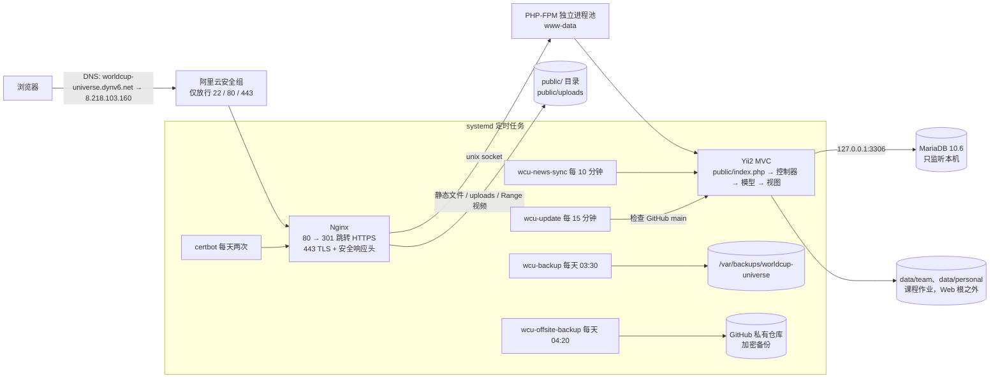
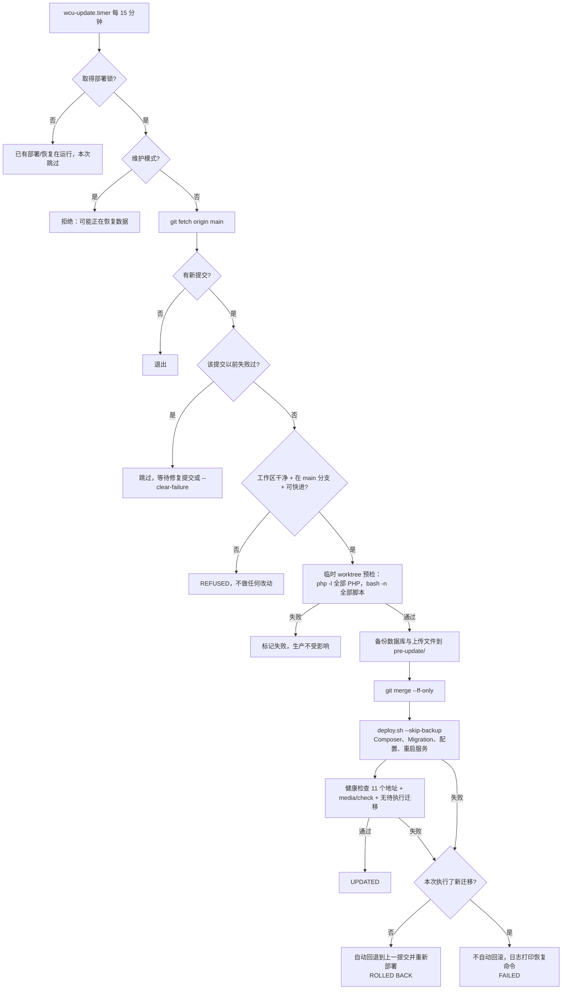
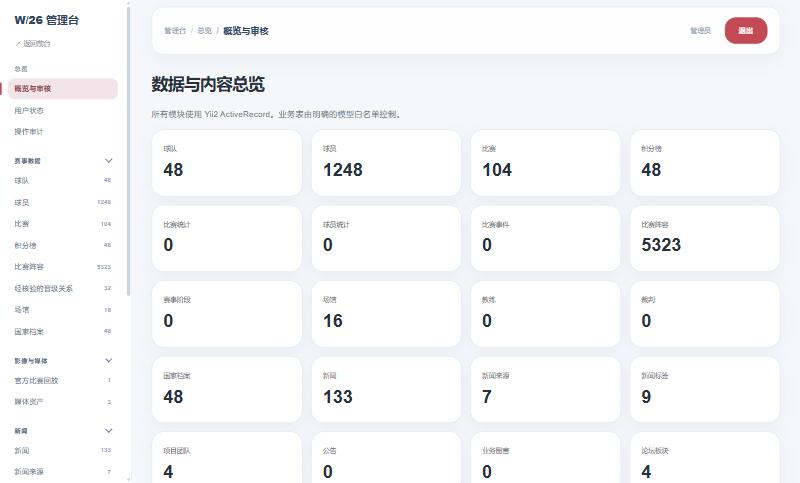
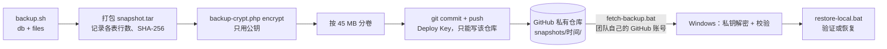

# WorldCup Universe 部署技术说明书

> 课程团队作业“部署文档”。本文说明网站如何部署到公网（阿里云 ECS）与本地 Windows、为什么这样设计、每个脚本具体做了什么，以及出现故障时怎样恢复。
> 正式访问地址：**https://worldcup-universe.dynv6.net/**
> 文中命令、路径与配置均以仓库当前代码和 2026-11 的生产环境为准。

目录

1. [部署概述](#1-部署概述)
2. [系统部署架构](#2-系统部署架构)
3. [公网部署环境](#3-公网部署环境阿里云-ecs)
4. [公网部署流程与原理](#4-公网部署流程与原理)
5. [GitHub 自动更新机制](#5-github-自动更新机制)
6. [Windows 一键本地部署](#6-windows-一键本地部署)
7. [数据持久化与备份恢复](#7-数据持久化与备份恢复)
8. [常见故障与应急部署](#8-常见故障与应急部署)
9. [部署验收与总结](#9-部署验收与总结)

---

## 1. 部署概述

### 1.1 技术栈

| 层次 | 技术 | 说明 |
|---|---|---|
| Web 框架 | **PHP + Yii2 2.0.55（原生 MVC）** | 控制器 `controllers/`、模型 `models/`（ActiveRecord）、视图 `views/`；单一入口 `public/index.php` |
| 数据库 | **MariaDB 10.4+**（生产 10.6） | 必须是 MariaDB：`data/install.sql` 在 VARCHAR(800/900) 上建了唯一索引，MariaDB 10.4+ 用哈希实现长唯一键，MySQL 8 会报 1071 无法建表 |
| 数据库变更 | Yii2 Migration（`migrations/`） | `php yii app/install` 建基础表并执行迁移；之后的结构变化都通过迁移完成 |
| Web 服务 | Nginx + PHP-FPM（生产）/ PHP 内置服务器（本地） | 生产由 Nginx 直接服务静态文件和视频；本地使用 `php -S` |
| 定时任务 | systemd timer | 新闻同步、每日备份、异地备份、GitHub 自动更新、证书续期 |
| HTTPS | Let's Encrypt（certbot，webroot 方式） | 免费证书，自动续期 |

### 1.2 部署目标

- **公网正式部署**：阿里云 ECS（Ubuntu 22.04）上运行 Nginx + PHP-FPM + MariaDB，绑定域名并启用 HTTPS；GitHub `main` 分支的新提交在 15 分钟内自动、安全地上线；数据每天备份到本机并加密备份到 GitHub 私有仓库。
- **本地演示部署**：拿到随作业提交的完整源码后，在 Windows 上双击 `deploy-local.bat` 即可得到一个功能完整（前台、后台、论坛、上传下载）的本地网站；云服务器不可用时它也是应急演示方案。

### 1.3 软硬件要求

| | 公网服务器（当前生产） | Windows 本地 |
|---|---|---|
| 系统 | Ubuntu 22.04 LTS（24.04 亦可） | Windows 10 / 11 |
| 硬件 | 2 vCPU、约 2 GB 内存（另配 1 GB swap）、40 GB 磁盘 | 普通 PC；约 500 MB 磁盘 |
| PHP | 8.1（apt 安装） | **8.1 及以上**，扩展 pdo_mysql、mbstring、curl、fileinfo、openssl |
| 数据库 | MariaDB 10.6（apt 安装） | **MariaDB 10.4+**（推荐直接安装 XAMPP 8.2.x，自带 PHP 8.2 与 MariaDB 10.4） |
| 其他 | Nginx 1.18、Composer 2、certbot、git | 源码已包含 `vendor/` 时不需要 Composer；取回异地备份需要 Git for Windows |

---

## 2. 系统部署架构



关键设计：

- **只有 `public/` 是 Web 根目录**。`.env`、源码、`vendor/`、日志、课程作业和备份都在 Web 根之外；Nginx 还对所有点文件（`.env`、`.git`）返回 404，对 `public/` 下除 `index.php` 以外的 `.php` 返回 404，对 `/uploads/` 中的脚本、HTML、SVG 返回 403 并加沙箱 CSP。
- **数据库不对外**：MariaDB 只监听 `127.0.0.1`，安全组也不放行 3306；应用使用只拥有本库权限的独立账号 `wcu_app`。
- **代码与可写目录分离**：代码属于部署用户 `wcu-deploy`，PHP 进程 `www-data` 只能写 `storage/`、`public/uploads/`、`data/team|personal/` 和视频目录，不能改代码。
- **持久化数据**：数据库 + 上传文件 + 课程作业 + `.env` 都不在 Git 中，`git pull` 和重新部署不会动它们，由备份负责保护（第 7 节）。

---

## 3. 公网部署环境（阿里云 ECS）

| 项目 | 当前值 |
|---|---|
| 实例 | 阿里云 ECS，中国香港，2 vCPU / 约 1.7 GiB 内存 / 40 GiB 系统盘，个人免费试用（不额外购买任何云资源） |
| 公网 IP / 域名 | `8.218.103.160` / `worldcup-universe.dynv6.net`（dynv6 免费域名，静态 A 记录，无 AAAA 记录） |
| 系统与软件 | Ubuntu 22.04.5、Nginx 1.18.0、PHP 8.1.2（FPM）、MariaDB 10.6.23、Composer 2.2.6、Yii 2.0.55 |
| 部署目录 | `/var/www/worldcup-universe`（跟踪 GitHub `main` 分支），部署用户 `wcu-deploy`（sudo 需密码） |
| 访问地址 | https://worldcup-universe.dynv6.net/ ，后台 `/admin` |


### 3.1 网络与安全组

阿里云 Ubuntu 镜像的主机防火墙默认不拦截流量（ufw 未启用，iptables 全部 ACCEPT），**入站过滤由安全组负责**。安全组入方向只需要：

| 端口 | 来源 | 用途 |
|---|---|---|
| TCP 22 | 建议限制为自己的 IP | SSH 运维 |
| TCP 80 | 0.0.0.0/0 | HTTP（跳转 HTTPS，以及 Let's Encrypt 验证） |
| TCP 443 | 0.0.0.0/0 | HTTPS |

**不放行 3306**；即使放行，MariaDB 也只监听 127.0.0.1（`deploy/mariadb/60-worldcup-universe.cnf`）。安全组规则不收费。

> 部署时遇到过的真实问题：Nginx 已在服务器上监听 80，但公网始终连不上。在服务器网卡上抓包（`tcpdump -ni any 'tcp port 80'`）发现外部 SYN 包根本没有到达，从而确定是安全组未放行，而不是 Nginx 配置问题。

### 3.2 DNS 与 HTTPS

1. 在 dynv6 为 `worldcup-universe.dynv6.net` 设置 A 记录 → `8.218.103.160`（用 `nslookup worldcup-universe.dynv6.net 223.5.5.5` 验证）。
2. `deploy.sh --domain worldcup-universe.dynv6.net --email <邮箱>` 用 **webroot 方式**申请证书：certbot 把验证文件写到 `/var/www/letsencrypt/.well-known/acme-challenge/`，Nginx 的 80 端口对该路径直接提供文件，其余请求一律 301 到 `https://worldcup-universe.dynv6.net`。
3. 证书生效后脚本把 Nginx 切换到 HTTPS 模板（TLS 1.2/1.3、HTTP/2、HSTS `max-age=31536000`），并把 `.env` 的 `APP_URL` 改为 `https://…`。Yii2 据此给会话、身份、CSRF Cookie 加上 `Secure; HttpOnly; SameSite=Lax`。
4. 续期：Ubuntu 的 `certbot.timer` 每天检查两次，到期前 30 天自动续期；续期成功后 `/etc/letsencrypt/renewal-hooks/deploy/reload-nginx.sh` 重新加载 Nginx。用 `sudo certbot renew --dry-run` 演练（已验证成功）。
5. 安全限制：生产环境（`APP_ENV=production`）拒绝来自公网的明文 HTTP 登录/注册（返回 403），`.env` 中 `ALLOW_INSECURE_LOGIN` 保持为空。

---

## 4. 公网部署流程与原理

### 4.1 首次部署的步骤

```bash
# 1. 1 GB swap（2 GB 内存的机器建议配置）
sudo fallocate -l 1G /swapfile && sudo chmod 600 /swapfile && sudo mkswap /swapfile && sudo swapon /swapfile
echo '/swapfile none swap sw 0 0' | sudo tee -a /etc/fstab
echo 'vm.swappiness=10' | sudo tee /etc/sysctl.d/60-wcu-swap.conf && sudo sysctl -p /etc/sysctl.d/60-wcu-swap.conf

# 2. 取得代码
sudo mkdir -p /var/www && sudo chown "$USER" /var/www
git clone -b main https://github.com/Aqs-1733/worldcup-universe.git /var/www/worldcup-universe
cd /var/www/worldcup-universe

# 3. 安装软件并部署（先只用 HTTP，确认公网 80 可达）
sudo bash scripts/deploy.sh --install-packages --skip-tls

# 4. 域名解析生效后申请证书，切换到 HTTPS
sudo bash scripts/deploy.sh --domain worldcup-universe.dynv6.net --email <联系邮箱>

# 5. （可选）异地加密备份，见 7.3；启用 GitHub 自动更新，见 5.4
```

### 4.2 `scripts/deploy.sh` 实际做了什么

`deploy.sh` 是唯一的部署实现，首次部署、手动更新和自动更新都调用它；它**可以重复执行**，已有数据不会被覆盖。

| 步骤 | 内容 | 原理 / 理由 |
|---|---|---|
| 加锁 | `flock /run/lock/wcu-deploy.lock` | 与自动更新、恢复脚本共用一把锁，同一时间只有一个任务改动服务器 |
| 安装软件（`--install-packages`） | `apt install nginx mariadb-server php-fpm php-mysql php-mbstring php-curl php-xml php-zip php-intl composer certbot` | 不做系统版本升级，只装需要的包 |
| `.env` | 首次由 `deploy/env.production.example` 生成：随机 `DB_PASSWORD`、`ADMIN_PASSWORD`、64 位十六进制 `YII_COOKIE_VALIDATION_KEY`，`APP_ENV=production`，权限 640 | 已存在时只补缺失的键，**从不重置密码和密钥** |
| 数据库 | 安装 `deploy/mariadb/60-worldcup-universe.cnf`（buffer pool 256M、max_connections 40、只监听 127.0.0.1）；以 root 本地 socket 创建库 `worldcup_universe` 和账号 `wcu_app`（仅本库权限） | 小内存机器的调优；root 使用 Ubuntu 默认的 auth_socket，无需密码 |
| 目录权限 | 可写目录设为 `wcu-deploy:www-data`、2775（setgid） | `www-data` 只能写数据目录，不能改代码 |
| 部署前备份 | 已有数据库时，先备份到 `/var/backups/worldcup-universe/pre-deploy/` | 迁移出错时可回到部署前状态 |
| 依赖 | `composer install --no-dev --optimize-autoloader` | 生产不装开发依赖 |
| Yii2 安装与迁移 | 以 `www-data` 执行 `php yii app/install`、`php yii migrate/up`；全新库额外执行 `release/metadata`；`cache/flush-all`；`media/check` | `app/install`：建基础表 → 迁移 → **空库才导入**公开体育数据 → 管理员**只创建一次** |
| PHP-FPM | 生成独立进程池 `/etc/php/8.1/fpm/pool.d/worldcup-universe.conf`：内存 < 2 GB 时 `pm.max_children=5`；上传上限按 `.env` 中最大值（200 MB）；`disable_functions` 禁止执行外部程序 | 独立池便于限制资源和隔离 |
| Nginx | 由 `deploy/nginx/*.template` 渲染站点；有证书用 HTTPS 模板，否则 HTTP 模板；`nginx -t` 通过后 reload | 访问控制规则集中在 `app.conf.template` |
| 证书（`--domain --email`） | `certbot certonly --webroot`，安装续期钩子 | 见 3.2 |
| systemd | 安装 `wcu-news-sync`、`wcu-backup`、`wcu-update`、`wcu-offsite-backup` 服务与定时器；启用新闻同步与每日备份；`/etc/worldcup-universe/offsite.conf` 存在时启用异地备份 | 自动更新定时器需要管理员显式启用（5.4） |
| 冒烟测试 | `/` 必须 200、`/.env` 必须 404，否则以失败退出 | 部署“成功”必须有证据 |

关键配置示例（Nginx，节选自 `deploy/nginx/app.conf.template`）：

```nginx
root /var/www/worldcup-universe/public;          # 唯一 Web 根
location ~ /\. { return 404; }                   # .env、.git 等点文件
location ^~ /uploads/ {                           # 后台上传：只当静态文件
    location ~* \.(php\d?|phtml|phar|html?|svg|js)$ { return 403; }
    add_header Content-Security-Policy "default-src 'none'; img-src 'self'; media-src 'self'; sandbox" always;
}
location = /index.php {                           # 只有前端控制器交给 PHP-FPM
    if (-f /var/www/worldcup-universe/storage/runtime/maintenance.flag) { return 503; }
    fastcgi_pass unix:/run/php/worldcup-universe-fpm.sock;
}
location ~ \.php$ { return 404; }                 # 其他任何 .php 都不执行
```

### 4.3 定时任务一览

| 定时器 | 时间 | 作用 |
|---|---|---|
| `wcu-news-sync.timer` | 每 10 分钟 | `php yii news/sync` 拉取 RSS；`flock` + Yii FileMutex 防重复；失败来源记录在后台“新闻来源” |
| `wcu-backup.timer` | 每天 03:30 | `scripts/backup.sh`，本机保留 14 天 |
| `wcu-offsite-backup.timer` | 每天 04:20 | `scripts/offsite-backup.sh`，加密推送到 GitHub 私有仓库 |
| `wcu-update.timer` | 每 15 分钟 | `scripts/update-production.sh`，检测并部署 GitHub `main` 新提交 |
| `certbot.timer` | 每天两次 | 证书续期 |

---

## 5. GitHub 自动更新机制

### 5.1 流程



### 5.2 设计要点

- **只推送测试过的代码到 `main`**：服务器只做快进（`--ff-only`），历史被改写时拒绝更新；服务器上被跟踪文件有未提交修改时也拒绝，防止覆盖手工修改。
- **先预检后上线**：在 `/tmp` 的临时 worktree 中检查新提交的语法，生产目录完全不动。
- **先备份后迁移**：每次更新前备份到 `pre-update/`（保留 30 天）。
- **不会盲目回滚数据库**：只有“没有执行任何新迁移”时才自动回滚代码（此时数据库结构没变，回滚安全）；一旦执行过迁移，脚本停下并打印三种恢复方式（修复后再推送 / 只回滚代码 / 代码与数据一起回到更新前）。
- **失败不反复重试**：失败的提交写入 `/var/lib/worldcup-universe/update-failed`，之后的定时运行会跳过它，直到有新的修复提交或执行 `--clear-failure`。
- `.env`、管理员密码、数据库数据与上传文件都不会被更新流程重置。

### 5.3 健康检查内容

`/`、`/teams`、`/news`、`/forum`、`/watch`、`/login`、`/api/v1/home`、`/api/v1/session` 必须 200；`/admin` 必须 302（跳转登录）；`/.env`、`/composer.json` 必须 404；`php yii media/check` 通过；`php yii migrate/new` 没有待执行迁移。

### 5.4 常用命令

```bash
cd /var/www/worldcup-universe
sudo bash scripts/status.sh                                 # 一屏查看全部状态（见 8.1）
sudo bash scripts/update-production.sh --check              # 只看有没有更新
sudo bash scripts/update-production.sh                      # 立即更新，不等定时器
sudo bash scripts/update-production.sh --clear-failure      # 允许重试上次失败的提交
sudo tail -n 100 /var/log/worldcup-universe/update.log      # 每次更新的完整记录
sudo systemctl enable --now wcu-update.timer                # 启用自动更新（关闭：disable --now）
```

日志中的结果关键字：`UPDATED`（成功）、`REFUSED`（拒绝，未改动）、`FAILED`（失败）、`ROLLED BACK`（已自动回滚）。

同一份输出也保存在 systemd 日志中（`journalctl -u wcu-update -n 200`）；`update.log` 便于按时间查看历次更新，脚本退出前会等待日志写完，保证最后的结果行不会丢失。

---

## 6. Windows 一键本地部署

### 6.1 使用方法

**① 准备基础环境（只需一次）**

| 组件 | 要求 | 推荐做法 |
|---|---|---|
| PHP | 8.1 及以上 | 安装 **XAMPP 8.2.x**（https://www.apachefriends.org/ ，默认 `C:\xampp`），或从 https://windows.php.net/download/ 下载 PHP 8.2/8.3 x64 Thread Safe zip 解压 |
| MariaDB | 10.4 及以上 | XAMPP 自带（`C:\xampp\mysql\bin`）；**不需要**在 XAMPP 控制面板中启动它 |
| Composer | 仅当源码缺少 `vendor/` 时需要 | 随作业提交的完整源码已包含 `vendor/` |

**② 双击 `deploy-local.bat`**

脚本会依次完成 7 个步骤（检查 PHP → 检查依赖 → 生成配置 → 启动数据库 → Yii2 安装与迁移 → 启动网站 → 健康检查），全部通过后自动打开浏览器。首次运行需要约 1 分钟，**不需要输入任何配置**。真实运行输出（节选）：

```text
==> 1/7 检查 PHP（需要 8.1 及以上，扩展 pdo_mysql / mbstring / curl / fileinfo / openssl）
    [OK] PHP 8.4.25  D:\internet\.runtime\php-8.4.25\php.exe
    本项目临时启用扩展：extension=fileinfo, extension=sodium
==> 2/7 检查 Yii2 依赖（vendor 目录）
    [OK] vendor 已存在（随源码提交），无需 Composer
==> 3/7 本地配置 .env（首次运行自动生成，之后保持不变）
    [OK] 已生成 .env：随机数据库密码、管理员密码和 Yii2 Cookie 密钥（.env 不会提交到 Git）
==> 4/7 MariaDB（项目专用实例，端口 3317，数据在 storage\local-db）
    [OK] MariaDB 程序：D:\xampp\mysql\bin
    [OK] 已启动项目专用 MariaDB（PID 27460，端口 3317，仅监听 127.0.0.1）
    [OK] 10.4.32-MariaDB；数据库 worldcup_universe_local 已新建
==> 5/7 Yii2 安装与迁移（app/install：建表、迁移、空库才导入公开数据、管理员只创建一次）
    7 migrations were applied. ... Administrator created.
==> 6/7 启动网站 http://127.0.0.1:8080
    [OK] PHP 内置服务器已启动（PID 43764）
==> 7/7 健康检查
    /                  HTTP 200（应为 200）   …   /admin  HTTP 302（应为 302）   /.env  HTTP 404（应为 404）
 部署完成，网站运行中：http://127.0.0.1:8080/
 管理后台：http://127.0.0.1:8080/admin   用户名：admin
 初始管理员密码：（随机生成，已保存在 .env 的 ADMIN_PASSWORD）
```

**③ 访问**

- 前台：http://127.0.0.1:8080/
- 后台：http://127.0.0.1:8080/admin ，用户名 `admin`，密码为首次运行时屏幕上显示的初始密码（保存在项目根目录 `.env` 的 `ADMIN_PASSWORD`）。



**④ 停止与再次启动**

- 停止：双击 `stop-local.bat`（同时停止网站和项目专用数据库，数据保留；加 `-KeepDb` 只停网站）。
- 再次启动：再次双击 `deploy-local.bat`，已有数据不会被覆盖。关闭部署窗口不会停止网站。

**⑤ 常用参数**（在命令行中运行 `deploy-local.bat 参数`）

| 参数 | 用途 |
|---|---|
| `-Php D:\php82\php.exe` | 指定 PHP（只需指定一次，之后会记住） |
| `-MariaDbBin D:\XAMPP\mysql\bin` | XAMPP 不在 C/D/E 盘根目录时指定 MariaDB 程序目录 |
| `-Port 8090` | 8080 被占用时换端口 |
| `-UseExistingDb -DbPort 3306` | 首次部署时改用电脑上已运行的 MariaDB（会询问一次其管理员账号，用后不保存） |
| `-NoBrowser` | 完成后不自动打开浏览器 |

**⑥ 遇到问题怎么办**

| 屏幕提示 | 原因与处理 |
|---|---|
| 没有可用的 PHP 8.1+（找到但版本过低） | 例如旧版 XAMPP 自带 PHP 8.0：安装 XAMPP 8.2，或用 `-Php` 指定新 PHP |
| PHP 缺少扩展 | 在对应 `php.ini` 中启用 `extension=…`；ext 目录里有 DLL 的扩展脚本会自动临时启用 |
| 没有找到 MariaDB 10.4+ 程序 | 安装 XAMPP 或 MariaDB；或用 `-MariaDbBin` 指定目录。**MySQL 8 不受支持** |
| 端口 8080 已被 xxx（PID）占用 | 关闭该程序，或 `deploy-local.bat -Port 8090` |
| 端口 3317 已被占用 | 在 `.env` 中把 `DB_PORT` 改成其他空闲端口后重新运行 |
| 项目专用 MariaDB 没能启动 | 查看 `storage\local-db\mariadb-error.log`；项目路径尽量为纯英文 |
| 健康检查未通过 | 脚本会显示 `storage\logs\local-php-error.log` 和 `yii2.log` 的末尾；修复后重新运行 |

所有失败都以红色“[失败]”提示和非 0 退出码结束，**不会显示“部署完成”**。

### 6.2 实现原理（不用脚本时也可以照此手动部署）

文件组成：`deploy-local.bat` / `stop-local.bat`（双击入口，只负责调用 PowerShell）、`scripts/local/deploy-local.ps1`（主流程）、`scripts/local/db-setup.php`（建库建账号）、`scripts/local/stop-local.ps1`。旧的 `setup.ps1`、`start_php.bat` 保留为兼容入口，内部也调用 `deploy-local`。

| 步骤 | 脚本做了什么 | 手动等价操作 |
|---|---|---|
| 1 检查 PHP | 依次查找 `-Php` 参数、`WCU_PHP` 环境变量、上次记录的 PHP、项目内 `php*` 目录、`C:/D:/E:\xampp\php`、PATH，选第一个 ≥ 8.1 的；检查扩展，**ext 目录中有 DLL 但 php.ini 未启用的扩展用 `-d extension=…` 临时启用**（不修改 php.ini） | `php -v`、`php -m` 检查版本与扩展 |
| 2 依赖 | `vendor/yiisoft/yii2/Yii.php` 存在则跳过；否则用 Composer 安装 | `composer install --no-dev` |
| 3 配置 | `.env` 不存在时由 `.env.example` 生成：`APP_ENV=development`、`APP_URL`、数据库名与同名账号、**随机**数据库密码、**随机**管理员密码、64 位 Cookie 密钥；写入时不带 BOM。`.env` 已存在则原样保留 | 复制 `.env.example` 为 `.env` 并填写 |
| 4 数据库 | 默认使用 XAMPP 的 `mysqld.exe` 在 `storage\local-db\data` 建立**项目专用实例**（首次由 `mysql_install_db.exe` 初始化），端口 3317、只监听 127.0.0.1；随后 `db-setup.php` 通过 PDO 检查版本（拒绝 MySQL 与低于 10.4 的 MariaDB）、`CREATE DATABASE IF NOT EXISTS`、创建只拥有该库权限的账号。密码只通过环境变量传给 PHP，不出现在命令行 | 在 MariaDB 中建库、建用户并授权 |
| 5 Yii2 | `php yii app/install`（建表、迁移、**空库才导入** `data/sports-seed.sql` 公开数据、管理员**只创建一次**）→ `migrate/up` → 新库执行 `release/metadata` → `cache/flush-all` → `media/check` | 同左逐条执行 |
| 6 启动 | 端口空闲时以隐藏窗口启动 `php -S 127.0.0.1:8080 -t public public/index.php`（上传上限 210 MB），PID 记录在 `storage\runtime\local-server.pid`；若端口已被本脚本启动的网站占用则沿用，被其他程序占用则报错并指出占用者 | `php -S 127.0.0.1:8080 -t public public/index.php` |
| 7 健康检查 | 请求 `/`、`/teams`、`/worldcup`、`/forum`、`/news`、`/login`、`/api/v1/session`（200），`/admin`（302），`/.env`（404） | 浏览器访问 |

**为什么默认用“项目专用 MariaDB”**：很多电脑上 3306 端口已被 MySQL 8 或其他 XAMPP 项目占用（本机测试时 3306 正是 Windows 服务 MySQL80），而本项目只能运行在 MariaDB 上。专用实例使用独立端口和数据目录，不需要 root 密码，不影响电脑上的其他数据库，数据随项目目录保存。

**为什么可以安全地重复运行**：`.env` 存在即不改；数据库用 `IF NOT EXISTS` 创建；`app/install` 在已有体育数据时跳过公开数据、管理员已存在时不改密码；上传目录只创建不清空；网站已在运行时直接沿用。实测重复运行前后用户数、帖子数、新闻数、管理员密码哈希、`.env` 与上传文件的校验值完全一致（第 9 节）。

**两种初始化的区别**：`deploy-local.bat` 用随源码提交的**公开数据**（48 支球队、1248 名球员、104 场比赛、新闻样例）初始化一个新网站；要得到生产服务器上的**真实数据**（用户、论坛、后台上传的文件、课程作业），使用第 7.4 节的 `fetch-backup.bat` + `restore-local.bat`。

---

## 7. 数据持久化与备份恢复

### 7.1 需要保护的数据

| 数据 | 位置（生产） | 是否在 Git 中 | 备份方式 |
|---|---|---|---|
| 数据库（用户、论坛、新闻、后台修改的内容） | MariaDB `worldcup_universe` | 否 | `db-*.sql.gz` |
| 后台上传的图片、视频 | `public/uploads/年/月/随机名` | 否 | `files-*.tar.gz` |
| 课程作业（后台上传的保存在 `uploads/`） | `data/team`、`data/personal` | 否（内置作业文件在 Git 中） | `files-*.tar.gz` |
| AI 识图私有上传 | `storage/uploads` | 否 | `files-*.tar.gz` |
| 配置与密钥 | `.env` | 否 | `files-*.tar.gz`（加密后才离开服务器） |
| 本地开放授权视频库（约 180 MB） | `public/assets/media/videos` | 否 | `videos-*.tar.gz`，**只在内容变化时生成** |
| 源码 | Git | 是 | GitHub |

### 7.2 本机备份（`scripts/backup.sh`，每天 03:30）

- `mysqldump --single-transaction`（不锁表）压缩为 `db-时间.sql.gz`；数据库密码通过 0600 临时配置文件传递，不出现在进程列表。
- 上传文件、课程作业、AI 上传和 `.env` 打包为 `files-时间.tar.gz`。
- 视频库单独打包，且仅当目录内容（文件名、大小、修改时间的摘要）与上次不同时才重新打包，最新一份视频归档始终保留——避免每天重复保存 180 MB 不变的数据。部署和自动更新前的备份不含视频（部署不会改动它）。
- 目录 `/var/backups/worldcup-universe/`（root，0700），保留 14 天；`pre-deploy/`、`pre-update/`、`pre-restore/` 分别是部署、更新、恢复前的安全备份。

### 7.3 异地加密备份（`scripts/offsite-backup.sh`，每天 04:20）

单机备份防不了整台服务器丢失，因此每天再把数据推送到 GitHub **私有**仓库 `Skylar-Jiang/worldcup-universe-backups`。由于备份包含用户信息和 `.env` 密钥，绝不能放进公开的代码仓库，而且推送前必须加密。



- **加密**：`scripts/backup-crypt.php`（PHP sodium 扩展，服务器与 Windows 共用）。每份备份生成一次性随机密钥，用 XChaCha20-Poly1305 分块（1 MB）认证加密，随机密钥再用团队公钥封装（sealed box）。**服务器只保存公钥**，能写备份但读不了；私钥只在负责人电脑的 `%USERPROFILE%\.worldcup-universe\backup-secret.key`。任何字节被篡改、分卷缺失或顺序错误，解密都会报错而不是输出错误数据。
- **推送权限**：服务器使用只对该私有仓库有写权限的 SSH Deploy Key（`/etc/worldcup-universe/offsite_deploy_ed25519`），碰不到代码仓库；GitHub 主机密钥按 GitHub API 公布的值固定在 `/etc/worldcup-universe/github_known_hosts`。只做普通推送，不强推。
- **仓库内容**：`snapshots/<时间>/backup.wcub.part-NNN`（加密分卷）和 `summary.json`（非敏感元数据：大小、SHA-256、各表行数、上传文件数），工作区保留最近 14 份。当前每份约 0.9 MB（不含视频库；`OFFSITE_INCLUDE_VIDEOS=1` 可包含）。
- **配置**：`/etc/worldcup-universe/offsite.conf`（root 0600）：

```bash
OFFSITE_REPO=git@github.com:Skylar-Jiang/worldcup-universe-backups.git
OFFSITE_SSH_KEY=/etc/worldcup-universe/offsite_deploy_ed25519
OFFSITE_PUBLIC_KEY=/etc/worldcup-universe/backup-public.key
OFFSITE_KEEP=14
OFFSITE_INCLUDE_VIDEOS=0
```

- **一次性设置步骤**（已完成，换服务器时照做）：① 在团队电脑上 `php scripts/backup-crypt.php keygen 私钥路径 公钥路径`；② 新建 GitHub 私有仓库；③ 服务器上 `ssh-keygen -t ed25519` 生成 Deploy Key 并在仓库 Settings → Deploy keys 中添加（勾选写权限）；④ 公钥复制到服务器、写 `offsite.conf`；⑤ `sudo bash scripts/deploy.sh` 启用定时器；⑥ `sudo bash scripts/offsite-backup.sh` 立即运行一次。
- **私钥务必另存一份**（U 盘或密码管理器）。私钥丢失 = 所有异地备份无法解密。

### 7.4 下载备份到 Windows 并恢复

```text
fetch-backup.bat                                   下载并解密最新一份到 backups\<时间>\
fetch-backup.bat -Snapshot 20261117-224533         指定某一份
restore-local.bat -Snapshot 20261117-224533        验证：导入独立的 worldcup_universe_restorecheck 库并逐表核对行数
restore-local.bat -Snapshot 20261117-224533 -IntoLocalSite   用生产数据替换本地网站（先自动备份本地数据，需输入 YES）
```

- `fetch-backup` 使用你自己的 GitHub 登录（Git Credential Manager / `gh auth login`）克隆私有仓库到 `%USERPROFILE%\.worldcup-universe\backup-repo`；若 git 配置的代理连不上，会依次改用本机正在监听的 7900、7897 端口代理和直连重试（只对这次命令生效，不改 git 配置；也可设置 `WCU_GIT_PROXY`）。解密后校验 SHA-256，再解包为 `db-*.sql.gz`、`files-*.tar.gz`、`summary.json`。
- `backups\` 目录含真实数据和密钥，已加入 `.gitignore`，用完请删除。
- 兼容性处理：生产 MariaDB 10.6 导出的 SQL 第一行是 `/*M!999999\- enable the sandbox mode */`，XAMPP 的 10.4 客户端不认识它，`restore-local` 解压时会去掉这一行（它不含数据）。
- `-IntoLocalSite` 恢复后，本地网站的账号密码与生产一致；本地 `.env` 保持不变。

### 7.5 在生产服务器上恢复

```bash
ls /var/backups/worldcup-universe/
sudo bash scripts/restore.sh --db …/db-时间.sql.gz --files …/files-时间.tar.gz          # 演练，只显示将覆盖什么
sudo bash scripts/restore.sh --db …/db-时间.sql.gz --files …/files-时间.tar.gz --yes    # 执行
sudo bash scripts/restore.sh --files …/videos-时间.tar.gz --yes                         # 需要时恢复视频库
```

`restore.sh` 的顺序：取得部署锁 → `maintenance.sh on`（Nginx 对动态请求返回 503、停止定时器、等待进行中的请求、停止 PHP-FPM）→ 把当前状态备份到 `pre-restore/` → 导入数据库与文件 → `migrate/up` 与清缓存 → 启动 PHP-FPM、关闭维护模式。数据尚未改动时出错会自动恢复网站；导入过程中出错则保持维护模式并打印用 `pre-restore/` 回到原状的命令。默认保留当前 `.env`。

---

## 8. 常见故障与应急部署

### 8.1 先看状态

```bash
sudo bash /var/www/worldcup-universe/scripts/status.sh
```

一屏显示：部署的提交与 GitHub 是否一致、最近一次自动更新结果、是否有被标记失败的提交、Nginx/PHP-FPM/MariaDB 状态、各定时器上次结果与下次时间、首页状态码、证书剩余天数、本机与异地备份的时间、磁盘与内存。有问题时在末尾列出 `ATTENTION` 并以退出码 1 结束。实际输出（节选）：

```text
Code
  deployed               9957b24 on main (…)
  origin/main            9957b24  (up to date)
Services
  nginx                  active
  php8.1-fpm             active
  mariadb                active
Website
  https://worldcup-universe.dynv6.net/ HTTP 200
  certificate            valid until Feb  6 13:04:12 2027 GMT (80 days)
Backups
  nightly (server)       db-20261117-033045.sql.gz 824K, 19h ago
  off-site (GitHub)      {"result":"ok","message":"pushed snapshots/20261117-224533","size":"860K",…}
All checks passed.
```

### 8.2 典型问题处理

| 现象 | 诊断 | 处理 |
|---|---|---|
| **域名打不开** | `nslookup worldcup-universe.dynv6.net 223.5.5.5` 是否为 8.218.103.160；`curl -I http://8.218.103.160/` | 解析错误：在 dynv6 修正 A 记录；IP 也不通：检查安全组 80/443、实例是否运行 |
| **公网不通但服务器上 `curl http://127.0.0.1/` 正常** | `sudo tcpdump -ni any 'tcp port 80'` 同时从外部访问 | 收不到 SYN：安全组/ACL 拦截；收到但无响应：`sudo ss -tlnp` 看 Nginx 是否监听 |
| **HTTPS 证书错误/过期** | `status.sh` 的 certificate 行；`sudo certbot certificates` | `sudo certbot renew` 后 `sudo systemctl reload nginx`；证书丢失则重新 `sudo bash scripts/deploy.sh --domain … --email …` |
| **502 Bad Gateway** | `systemctl status php8.1-fpm`；`tail storage/logs/php-fpm-error.log` | `sudo systemctl restart php8.1-fpm`；配置损坏时 `sudo bash scripts/deploy.sh` 重新生成 |
| **500 错误** | `tail -n 50 storage/logs/yii2.log` | 按错误修复；若刚更新导致，见下一行 |
| **Nginx 起不来** | `sudo nginx -t`；`journalctl -u nginx -n 50` | 按提示修复配置，或 `sudo bash scripts/deploy.sh` 重新渲染 |
| **数据库连接失败** | `systemctl status mariadb`；`journalctl -u mariadb -n 50`；`df -h /` | `sudo systemctl restart mariadb`；磁盘满先清理旧备份；数据损坏用 7.5 恢复 |
| **一直 503** | `scripts/maintenance.sh status` | 恢复中断导致：先按 `restore.sh` 打印的命令恢复，确认数据无误后才 `maintenance.sh off` |
| **自动更新失败** | `status.sh`；`sudo tail -n 200 /var/log/worldcup-universe/update.log` | 修复后推送新提交（推荐）；或按日志中的 2b/2c 命令回滚，见 5.2 |
| **自动更新一直不执行** | `status.sh` 中 “tracked file(s) modified” 或 “marked failed” | 撤销服务器上的手工修改（`git status` 查看）；或 `update-production.sh --clear-failure` |
| **新闻同步显示失败** | 后台“新闻来源”的错误信息 | ESPN（403）、CBS（429）是对方拒绝服务器 IP，属外部原因；其余来源正常即可 |

### 8.3 云服务器完全不可用时

1. **立刻恢复可演示的网站**：在任意 Windows 电脑上解压随作业提交的完整源码，双击 `deploy-local.bat`（第 6 节），几分钟内得到功能完整、使用公开数据的网站。
2. **需要线上的真实数据**：在持有私钥的电脑上运行 `fetch-backup.bat` 取得最近一次加密备份，`restore-local.bat -IntoLocalSite` 把真实数据恢复到本地网站。
3. **重建公网服务器**：新建 Ubuntu 主机 → 按 4.1 执行 `deploy.sh` → 把解密得到的 `db-*.sql.gz`、`files-*.tar.gz` 复制到服务器 → `sudo bash scripts/restore.sh --db … --files … --yes` → 把域名 A 记录改到新 IP → `deploy.sh --domain … --email …` 申请证书。

### 8.4 费用与资源

部署不使用任何额外收费的云服务（无快照、云盘、负载均衡、RDS；GitHub 私有仓库免费）。请在阿里云“费用与成本”中设置费用预警（预警只通知、不会自动停止扣费），并在免费额度用完或试用到期（2027-02-08）前确认最新异地备份可用后再释放实例。

---

## 9. 部署验收与总结

### 9.1 验收结果

以下均为实际执行的测试；写入型测试只使用独立测试库或测试账号，测试数据已清理。

| 项目 | 环境 | 结果 |
|---|---|---|
| 公网 HTTP/HTTPS | 生产 | HTTP 301 → HTTPS；证书链完整、域名匹配、TLS 1.3、HTTP/2、HSTS；`certbot renew --dry-run` 成功 |
| 前台页面与 API | 生产（HTTPS） | 首页、球队、球员、赛事、积分榜、新闻、论坛、影像馆等 23 个地址 200；`/.env` 等敏感路径 404，上传目录脚本 403 |
| 注册登录、Session、权限、后台 CRUD、论坛发帖/回复/收藏 | 生产（HTTPS，测试账号） | `tests/http_acceptance.py` 114 项通过 |
| 管理员上传图片/视频/课程文件与前台展示、下载权限 | 生产（HTTPS） | `tests/upload_acceptance.py` 41 项通过 |
| 本机备份 → 恢复 → 重新部署 | 生产（上线前） | 数据计数与标记文件哈希在恢复和重新部署后一致 |
| 自动更新 9 种场景 | 生产（本机临时仓库） | 无更新、拒绝脏工作区、正常更新、语法错误预检拦截且不重试、运行期故障自动回滚、修复后恢复更新、并发被锁阻止、执行迁移后失败不自动回滚，全部符合预期 |
| 真实提交自动上线 | 生产 | 推送到 `main` 的提交由定时器自动部署，日志 `UPDATED`，健康检查通过 |
| Windows 全新一键部署 | 本地（全新目录、全新数据库） | 7 步全部通过，退出码 0 |
| 重复运行不覆盖数据 | 本地 | 停止后再次部署：用户、帖子、新闻数，管理员密码哈希，`.env`、上传文件校验值完全一致 |
| 本地完整功能 | 本地 | `http_acceptance` 114 项、`upload_acceptance` 41 项通过 |
| 错误提示 | 本地 | PHP 8.0 被拒绝并给出安装说明；端口占用指出占用进程；数据库不可达/需要管理员账号分别报错；均不显示“部署完成” |
| 加密备份 | 本地 | 往返一致；篡改、缺分卷、乱序、错误私钥均被拒绝 |
| 异地备份 → 下载 → 隔离恢复 | 生产 → GitHub 私有仓库 → 本地 | 推送成功；Windows 解密 SHA-256 一致；导入独立库后 48 张表行数与备份时完全一致；恢复到本地网站后启动与健康检查通过 |

### 9.2 已知限制

- GitHub 自动更新只部署 `main`；推送到 `main` 的代码会在 15 分钟内上线，必须先在本地测试。
- 异地备份默认不含 180 MB 的开放授权视频库（可从 Wikimedia 重新获取，且服务器每日备份中保留）。
- 异地备份仓库的 Git 历史会随时间增长（目前每天约 1 MB）；如超过 1 GB，可新建仓库重新开始。
- 本地部署使用 PHP 内置服务器，适合演示，不用于公网。
- 部分新闻源（ESPN、CBS）拒绝云服务器 IP，属外部限制。

### 9.3 总结

整套部署保持了 PHP + Yii2 原生 MVC + MariaDB 架构：公网使用 Nginx + PHP-FPM + HTTPS，只开放必要端口；`deploy.sh` 是唯一的部署实现，首次部署、手动更新、自动更新和本地之外的重建都复用它；自动更新具备预检、备份、健康检查、失败阻止和安全回滚；数据有本机每日备份与加密异地备份两层保护，并经过真实的恢复验证；云服务器不可用时，随作业提交的源码可在 Windows 上一键恢复出可演示的网站。

---

相关文档：[数据采集与维护](v2-deployment.md) · [Oracle Cloud 历史适配方案](deployment-oracle-ubuntu.md)
