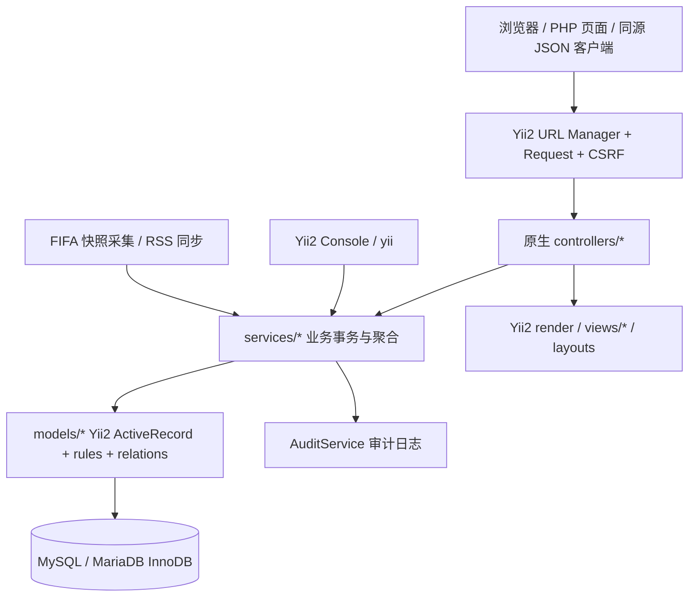
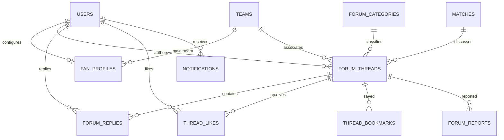
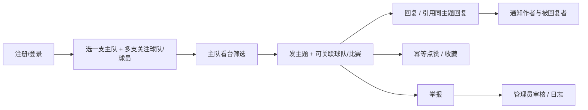

# WorldCup Universe V2｜后端架构与全站设计

版本：2026-10-21。技术基线为 `Aqs-1733/worldcup-universe` 的 `ca280bd`，不是另一个 FastAPI/React 项目。开发工作区为 `D:/Project114514/worldcup-universe`。

## 1. 需求来源与优先级

- 老师课件 L5–L8：Yii2、真实 MVC、统一命名和 PHP 注释头；SQL 置于 `/data/install.sql`；团队/个人作业分别放 `/data/team/` 和 `/data/personal/`，页面提供下载；每人至少一套 M/V/C；设计/实现/手册/部署/PPT/录屏。
- 设计方案：沉浸式首页、动态球队球员、准确晋级路径、3D 国家探索、新闻与数据中心、团队展示。
- 最新需求：先完成 Yii2 后端与真实官方数据，再完善全站；球迷论坛支持单一主队。赛事与回放仅保留 2026 年，中文标题直接描述功能；所有球队展示配国旗；各模块使用不同的窄幅首图，不重复堆放说明、榜单或入口。
- 课件展示 Advanced 模板的前后台目录，但没有把模板目录名等同于全部业务要求。沿用现有 Yii2 Application，原生 Controller/ActiveRecord/View + 独立前后台 layout；不为改目录而丢弃现有 34 张表。

## 2. 架构与边界

核心业务不再经过 `LegacyBridgeController → AppRepository → 自定义 View`。原始采集脚本和历史代码保留以便回溯；它们不是当前网页的业务入口。官方体育资料由 `scripts/fetch_fifa.py` 采集，再经 `OfficialFifaSyncService` 核对证据并事务导入；新闻由原生 `NewsImportService` 读取媒体 RSS/Atom。旧第三方采集包不再覆盖已核验赛事数据。

- `models/`：原 34 张表都有对应 AR；附加论坛、主队、通知、媒体、课程交付与晋级边模型。
- `controllers/`：Site/Auth/Team/Player/Match/News/Country/Profile/Forum/Video/Ai/Api/Admin。
- `services/`：CatalogService、OfficialFifaSyncService、ForumService、PreferenceService、NewsImportService、AuditService，以及球队国旗展示辅助 TeamUi。
- `commands/` + `yii`：初始化、增量迁移、数据/媒体覆盖率审计、新闻同步。
- `views/layouts/main.php` 与 `admin.php`：前后台分离，但同一 Yii2 权限和数据库。
- 前台样式：Arena 的导航、赛事记分牌、球员卡片和按钮；Tabler 的头像、列表、数据栅格；Multiverse 的照片墙。保留各模板原件及许可，仅加载经过隔离的适配样式，避免把多个模板的全局 reset 叠加。
- 本地字体：Noto Sans SC 的 `WCU Sans` 子集用于中文界面；Mulish 用于界面拉丁文字；Anton 用于比分与数字；站酷庆科黄油体仅用于部分展示标题。所有字体附 OFL 文件，子集过程见 `scripts/build_fonts.py`。
- `v2-tokens.css`、`v2-site.css`、`arena-integration.css` 与 `matchday.css` 承担本站配色、响应式和页面适配；JS 做菜单、国旗选择器、分组折叠、晋级路径、图库与足球鼠标等渐进增强。当前实际加载入口以 `views/layouts/main.php` 为准，不以留存的旧皮肤文件为准。

## 3. 数据库与迁移

保留已有 34 张表及记录，表名不强行加前缀破坏现有导入工具；新字段/表均有迁移和 down。课件中的表名前缀属于建议，本项目用业务表与 AR 明确映射、数据库字典和注释落实可解释性。

增量内容：

| 对象 | 用途 | 约束 |
|---|---|---|
| users.auth_key/status | Yii2 身份、记住登录、停用账号 | 注册端不接收身份字段/角色 |
| news_articles.status | 草稿、发布、隐藏 | 前台仅 published |
| fan_profiles | 单一主队与简介 | user_id 主键，main_team_id 外键 |
| forum_categories | 讨论板块 | slug 唯一 |
| forum_threads | 主帖，可关联球队/比赛 | 作者、状态、锁定、置顶由服务赋值 |
| forum_replies | 回复与引用回复 | 引用须属于同一主题 |
| thread_likes/bookmarks | 点赞、私人收藏 | (thread_id,user_id) 唯一 |
| forum_reports | 举报与处理结果 | 对象归属核对、重复未处理举报拒绝 |
| notifications | 回复通知 | 接收者专属读取/标记已读 |
| match_progressions | 显式晋级边 | 同一目标位置/来源结果唯一，禁止环 |
| media_assets | 可替换媒体及来源许可 | 未 approved 不用于主视觉 |
| coursework_files | 作业下载登记 | 路径限制 data/team 或 personal |
| official_imports | 官方快照导入凭证 | manifest 哈希、来源清单、导入报告 |
| 体育资料 official_import_id | 公开可核验数据标记 | 指向通过完整性与哈希检查的导入；手工改动事实字段会清除此标记 |
| match_videos | 官方完整比赛视频登记 | 受控 provider/id、年份、来源、审核状态，不接收任意 iframe HTML |

完整字段、类型、主外键、可空性、默认值见 `docs/v2-database-dictionary.md`。`data/install.sql` 为可重放的基础数据库 SQL，`yii migrate` 处理增量变更。`data/sports-seed.sql`（若随发行版存在）只含公开比赛资料，不含用户、密码、论坛私信或 API Key。

## 4. 角色与权限

| 操作 | 访客 | 登录球迷 | 管理员 |
|---|---|---|---|
| 读公开赛事/档案/新闻/公开讨论 | 是 | 是 | 是 |
| 选择主队/关注/收藏/通知 | 否 | 仅本人 | 本人 |
| 发帖、回复、点赞、举报 | 否 | 是，校验/限频 | 是 |
| 改删主题/回复 | 否 | 仅作者，受锁定限制 | 可审核/改删 |
| 隐藏、恢复、锁定、置顶、处理举报 | 否 | 否 | 是 |
| 赛事、球队、球员、新闻 CRUD | 否 | 否 | 是 |
| 审计日志 | 否 | 否 | 只读 |
| 用户停用 | 否 | 否 | 不可停用自己或其他管理员 |

全部写操作保留 Yii2 CSRF；退出、删除、点赞、收藏、审核均 POST。API PATCH/DELETE 同样校验 CSRF，不以“API”名义关闭。注册密码哈希保存，角色只能由服务/部署流程写入；登录失败有 15 分钟窗口限频。公开序列化从不包含密码哈希/auth_key。

## 5. 论坛与主队流程

主队不是收藏表第一条记录，而是 fan_profiles 的显式外键。主队自动纳入关注；关注和屏蔽不能重叠。偏好保存由一个数据库事务完成。未提供字段的 JSON 局部更新保留原值；网页完整替换使用 replace_preferences=1。

帖子的作者/状态/锁定/置顶不接受公开请求赋值。回复的父引用必须在同主题且可见。隐藏主题仅作者/管理员可查看，已删除主题不可读。主题锁定后不接收新回复。点赞和收藏用“设置为开启/关闭”而不是盲目 toggle，重复请求不会重复累计。

## 6. 页面与交互完整清单

| 页面 | 内容 | 数据/交互 |
|---|---|---|
| / | Arena 主视觉、赛事、球员、论坛、新闻与项目成员入口 | 真实数据库资料；摄影与球队资料分别登记来源，不把历史场馆照片称为当届比赛现场 |
| /worldcup | 轮次/球队/状态筛选、按组折叠赛程、晋级图 | 48 队国旗；32 条来源明确的晋级边；国旗与队名同时呈现 |
| /worldcup/standings | 按组折叠的小组积分 | 由 72 场官方小组赛比分计算；赛事中心的唯一积分入口，不另设重复的数据导航 |
| /stats | 兼容旧链接 | 重定向到 /worldcup/standings，不复制一套积分页面 |
| /matches/{id} | 比分、点球、场馆、官方阵容 | 不用不存在的赛事事件、射门或球员统计填充图表；NULL 不是 0 |
| /teams、/players 及详情 | 搜索、足联/位置/球队筛选、号码、阵容、档案 | 分页；官方肖像；球队关联内容显示国旗；足球鼠标是交互贴图，不宣称照片人物有骨骼踢球动画 |
| /countries | 本地 Natural Earth 地图、Globe、国家与场馆照片墙 | 按需加载、WebGL 降级、可键盘操作的图库 |
| /news | 媒体最新 RSS/Atom、类型标签、搜索、来源/时间、详情 | 战术、球队、球迷、花絮等分类；不以本站生成的决赛简报冒充实时新闻 |
| /watch | 2026 年官方完整比赛播放器候选与列表 | RTVE 官方决赛 iframe 已找到来源及元数据；要求官方登录，实际视频帧播放仍待验收；不混入旧届比赛或集锦 |
| /forum、/fan-space | 板块、球队、主队看台、主题、回复、引用、点赞、收藏、举报 | 完整登录/所有权/锁定/审核链路 |
| /profile | 主队、关注、屏蔽、简介、内容偏好、收藏 | 内容偏好不是未经实现的外部推送承诺 |
| /profile/notifications | 本人回复通知 | 专属读取、标记已读 |
| /admin | 所有注册内容模块 CRUD、论坛审核、用户停用、操作日志 | Yii2 AccessControl + 模型白名单 |
| /deliverables | 课程要求清单、团队/个人文件下载 | 实际文件存在才发送，路径穿越拒绝 |
| /commentary、/vision | 可选 AI 创作、主动勾选生图、私人图片接收 | 未配置不虚构模型结果；视觉分析仍待模型适配 |

动效优先 CSS hover、响应式菜单、按组展开和轻量过渡；尊重 prefers-reduced-motion。手机触屏不强制显示自定义鼠标。功能标题和正文使用中文；真实媒体原题保留原文，不冒充已完成中文翻译。来源、许可和采集说明放在素材署名或本文，不作为每个模块重复出现的宣传小字。

## 7. 数据与媒体真实性

### 7.1 官方球队、球员与比赛

本次官方快照位于 `data/official/20261021/`，其 `manifest.json` 声明 48 队、1,248 球员、104 场比赛、104 份逐场详情。154 份原始响应包括 FIFA 官方赛历、48 份球队详情、104 份比赛详情及官方名单 PDF。每份保存来源 URL、响应状态、采集时间和 SHA-256；标准化文件另有哈希。本文不把 2026-10-21 的一次完整快照称为持续实时直播。

- 比赛：`https://api.fifa.com/api/v3/calendar/matches?idCompetition=17&idSeason=285023&language=en&count=500`。
- 球队：`https://api.fifa.com/api/v3/teams/{IdTeam}?language=en`。
- 逐场阵容与比分：`https://api.fifa.com/api/v3/live/football/17/285023/{IdStage}/{IdMatch}?language=en`。
- 名单 PDF：`https://fdp.fifa.org/assetspublic/ce281/pdf/SquadLists-English.pdf`。

导入器核对完整性和文件哈希，通过 `official_import_id` 区分可公开资料与历史待核验数据；保留旧球队、球员和比赛 ID 以维护用户关联。结果范围为 48 队、1,248 球员、104 场比赛、5,323 条实际返回的阵容记录、48 条小组积分和 32 条淘汰赛晋级边。阵容并非假定每场必有 52 条；小组占位符不误解为淘汰赛败者边。积分由小组比分推导，不额外声称实现全部 FIFA 同分排序细则。

球员的国家队出场、进球、身高、俱乐部等来自该版官方名单，不能当作当届比赛数据；姓名、FIFA ID 和肖像地址结合官方阵容响应核对。旧来源的射门、事件及个人当届统计未通过新凭证筛选，不用于前台。原始数据的真实性不等于本项目取得 FIFA 品牌或所有肖像的独立商业再授权；保留原始链接，不将站点称为官方网站。

### 7.2 新闻、模板与媒体

新闻从配置的媒体自身 RSS/Atom 获取，保存有时间戳、feed 哈希、原始标题、短摘要、分类和原文链接；不把旧决赛信息或本站生成文字伪装成实时媒体新闻。同步只在执行同步任务或后台触发后更新；页面轮询状态不等于浏览器自行抓取所有来源。连接失败逐来源记录，不据此填造文章。分类由关键词整理，不冒充媒体原始编辑分类；未翻译标题保留原文。

页面实际结合 Arena（uiCookies）、Tabler 1.4.0 和 Multiverse（HTML5 UP）的组件，原模板、MIT/CC BY/OFL 等声明留存于 `public/assets/vendor/` 与 `public/assets/fonts/`。原模板演示球队、演示比分、票价和照片未作为真实项目资料使用。当前真实摄影由 `public/assets/media/photos/library.json` 登记；全部是场馆或城市的历史照片，不能称为 2026 比赛现场。图片保留原像素，CSS 负责裁切与叠色。

48 个本地国旗来源于 FIFA 图像接口，清单位于 `public/assets/media/flags/manifest.json`。足球指针使用 Commons 的 `Soccerball.png` 透明贴图，作者与许可位于 `public/assets/media/football-texture.json`。球员肖像链接来自官方 FIFA 响应，不和 Commons 摄影混用。生成的 `stadium-hero-v2.png` 属于历史设计稿，不应再充作真实赛事新闻摄影。

机器可读素材、哈希与许可汇总见 `docs/v2-media-manifest.json`；读者署名入口为 `/credits`。该清单检查本地文件与登记哈希，不代替浏览器加载或完整播放验收。

### 7.3 2026 完整比赛候选

`docs/v2-video-sources.md` 记录 RTVE 2026 决赛视频 `17162172` 的官方页面、API 与 iframe 候选：`https://www.rtve.es/drmn/embed/video/17162172/`。官方页面声明该嵌入地址，元数据类型为 `Completo`；接口同时返回 `requireLogged=true`、`hasDRM=true`。该候选不是伪造视频 ID，也不以旧年比赛补充数量。其登录、DRM 与播放状态由官方播放器处理；当前元数据来源检查不等于已经观察到实际视频帧，不能记为播放验收完成。保留官方观看页，SBS 2026 全场目录作为官方外链；受 SAMEORIGIN 限制的整页不作为可嵌入播放器。

## 8. 当前边界与最终课程验收

代码测试、真实 HTTP 流程、迁移/回滚和桌面/手机页面检查分别记录，不把测试文件存在或测试计划写成通过结果。本轮结构和数据来源已更新，但最终测试结果、发布提交和页面截图必须由实际执行记录确认。当前待交包括正式个人作业、最终团队 PDF/PPT、本人 5–15 分钟录屏、成员确认的真实工作量；2026 完整比赛已有 RTVE 官方 iframe 候选及元数据，官方登录后的实际流播放仍待浏览器验收。

四名成员姓名、学号、学院可由用户现有 `个人作业2_2412096_王麒萱/build_assets.py` 核对；其中“前台信息架构”等是原型里的角色标签，不作为完成相应开发贡献的证据。课程对应位置与未完成项目见 `docs/v2-coursework.md` 和 `docs/coursework-traceability.md`。

AI 编码工具可以协助实现，但课件要求的“每名成员至少一套 M/V/C”和真实工作量需要成员本人确认、理解并留存提交记录；本次没有编造人员贡献。

## 2026-10-22 组件与导航更新

论坛采用保留的 MIT Tabler 卡片、列表组、头像与聊天组件，再由 scoped community.css / refinement.css 调整本站样式。来源：
- https://docs.tabler.io/ui/components/card
- https://docs.tabler.io/ui/components/list-group
- https://docs.tabler.io/ui/components/chat

晋级展示不再依赖 SVG 固定画布：native details 显式嵌套已核验胜者边，季军赛保留独立比赛入口，source 数据本身不修改。bracket-tree.js 仅增强球队路线与一键收起，禁用 JavaScript 时仍能逐轮展开／打开比赛。

CountryController::actionView 与 views/catalog/country.php 构成国家详情 MVC；列表是普通 anchor，无 JS 也可进入。country-directory.js 仅做本地条件过滤。CountryUi 负责首都和语言／货币词条的中文展示，不把翻译当作来源事实更新。

TeamPhoto 只接受清单内 year=2026、status=verified_2026_team_photo 且路径受控的本地图片；不存在的合照使用纯国旗设计，绝不由“最有名球员”替代。
